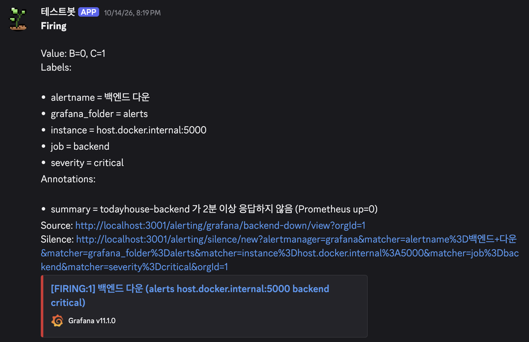
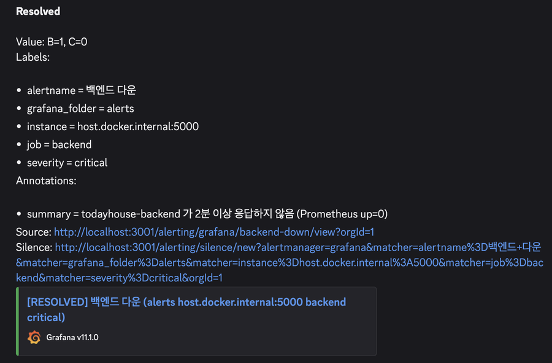
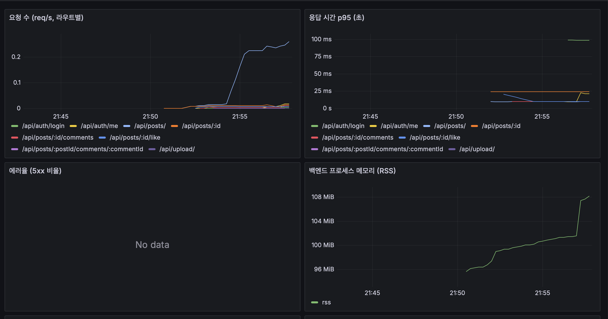
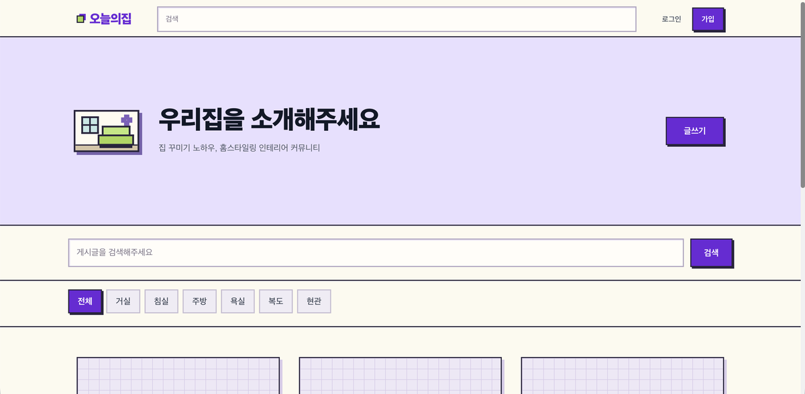

# 홈서버로 배운 네트워크·배포 — 학습공동체 "복학즈"

미니PC 한 대를 집 공유기 뒤에서 외부에 공개하고, 직접 만든 웹 서비스를 HTTPS로 올려 운영해 본 기록.
2025-2 숭실대 교수학습혁신센터 학습공동체 1기 **최우수**.

- 기간: 2025.09.15 – 2025.12.12 · 격주 Discord, 발표 + 실습
- 팀: 4인 — 각자 네트워크 주제 하나씩 발표, 홈서버 하나씩 구축, 서비스 하나씩 배포
- 서버: FIREBAT AK2 PLUS (N100, 16GB) · Ubuntu Server 24.04 · ipTIME 공유기
- 본인 역할: 네트워크 발표 2회(IP 활용 프로토콜 / 프록시 호스트·트래픽 라우팅), 홈서버 외부 공개 구성, 검증용 서비스(오늘의집 클론 게시판) 개발·배포
- 검증용 서비스: <https://todayhouseee.duckdns.org> — 이 저장소의 코드

## 시스템 구성

```
인터넷 ── https://todayhouseee.duckdns.org (DuckDNS, ddclient 5분 갱신)
   │
공유기 (포트포워딩 80/443 만 개방)
   │
N100 홈서버
   ├─ Nginx :443  ── SSL 종료 (Let's Encrypt)
   │     ├─ /       → Next.js :3002  (PM2)
   │     ├─ /api    → Express :5000  (PM2)
   │     └─ /metrics → 404 (외부 차단)
   ├─ PostgreSQL :5432          (Docker)
   └─ 모니터링 (Docker, 내부망 전용)
         Prometheus :9090 ← backend /metrics, node-exporter, cAdvisor
         Loki :3100       ← Promtail (PM2 로그)
         Grafana :3001    → Discord 알림
```

요청 흐름: DNS → 공유기 NAT → Nginx가 경로로 분기 → `/api`는 Express가 Prisma로 PostgreSQL 조회 → JSON 응답. 관리 포트(Grafana·Prometheus·NPM 81)는 포트포워딩하지 않고 Tailscale로만 접근.

## 배운 것

### 1. 집 안의 PC를 밖에서 접속하게 만들기

| 단계 | 한 것 | 알게 된 것 |
|---|---|---|
| 원격 접속 | ufw로 22/80/443만 열고, `sshd_config`에서 비밀번호 로그인 끄고 ed25519 키만 허용 | 공개 포트는 필요한 것만. 키 백업 안 하면 서버에 못 들어감 |
| 고정 IP | 공유기 DHCP에서 서버 MAC에 사설 IP 고정 | 포트포워딩 대상이 바뀌면 전부 깨짐 |
| DDNS | DuckDNS + cron 5분 갱신 스크립트(이후 ddclient) | 집 공인 IP는 통보 없이 바뀜 |
| 포트포워딩 | 공유기 관리 페이지로 80/443 → 서버 | 서버를 같이 쓰는 팀원이 공유기 UI(사설망)에 못 들어옴 → 서버 경유 SSH 터널(`ssh -L 8888:192.168.0.1:80`)로 열어 줌 |

- 처음 겪은 장애: 외부에서 타임아웃 → DDNS에 등록된 IP와 실제 공인 IP가 달랐음. 갱신 스크립트를 수동 실행해 동기화. 이후 "안 열리면 DNS → 공유기 → 서버 순서로 확인"이 습관이 됨

### 2. 리버스 프록시와 SSL 종료

- Nginx Proxy Manager(Docker)로 시작해 서브도메인 → 컨테이너 포트 매핑, 나중에 직접 쓴 Nginx 설정으로 교체([`deploy/nginx.todayhouse.conf`](deploy/nginx.todayhouse.conf))
- SSL은 프록시에서 끝냄 — 뒤의 Next.js·Express는 HTTP만 알면 됨, 인증서는 certbot 한 곳에서 관리
- 대신 `X-Forwarded-Proto`·`Host`·`X-Real-IP`를 넘겨줘야 함. 없으면 앱이 자기 주소를 `http://`로 만들고 클라이언트 IP가 프록시 IP로 찍힘
- 서브도메인 라우팅(`web1.도메인`) vs 경로 라우팅(`도메인/web1`) — 경로 방식은 앱이 서브경로를 지원해야 하고 쿠키·상대경로가 깨지기 쉬워 서브도메인이 편함. 이 서비스는 `/`와 `/api` 둘뿐이라 경로 방식
- WebSocket은 `Upgrade`·`Connection` 헤더 + HTTP/1.1 명시 필요. Next.js HMR 때문에 `/` 블록에 넣어둠
- 발표 때 정리한 것: upstream·가중치·`least_conn`·`ip_hash`·`max_fails` — 서버 한 대라 써 보진 못함

### 3. 관리 포트는 열지 않는다

- 외부 개방은 80/443 둘뿐. Grafana(3001)·Prometheus(9090)·NPM 관리(81)는 `127.0.0.1`에만 바인딩하고 Tailscale로 접속
- Nginx에서 `/metrics`는 404로 막음 — Prometheus는 호스트 내부에서 긁음
- 발표(ARP·ICMP)에서 본 것: ping에 응답 안 하는 서버가 많은 이유(ICMP flooding·스캔), 그래서 "ping 안 된다 ≠ 서버 죽었다"

### 4. 프로세스 관리와 장애 패턴

| 증상 | 원인이었던 것 | 확인 방법 |
|---|---|---|
| 타임아웃 | DDNS IP ≠ 실제 공인 IP | `curl ifconfig.me` vs `nslookup` |
| 502 Bad Gateway | 뒤에 프로세스 없음 (PM2 중지, 컨테이너 종료) | `pm2 ls`, `docker ps` |
| 403 Forbidden | 볼륨 마운트에 파일 없음, 소유자 권한 | `ls -la`, `chown` |
| 포트 충돌 | 8080을 두 컨테이너가 사용 | `ss -tlnp` |

- Nginx `client_max_body_size 10m`, `NEXT_PUBLIC_*`은 빌드 시점에 박히므로 `.env.production` 후 재빌드 — 설정에서 미리 잡아둔 것
- 재부팅 시 기동 순서: Docker(PostgreSQL) → Nginx → PM2 → ddclient. `pm2 save`·`--restart unless-stopped` 안 해두면 정전 한 번에 전부 내려감
- 서버를 오래 꺼뒀다 켤 때 체크리스트는 [`deploy/README.md`](deploy/README.md)

### 5. 모니터링과 알림 (학습공동체 종료 후 추가)

학습공동체 당시 모니터링은 PM2 프로세스 확인 수준. 2026.10 정리하면서 Docker Compose로 추가.

- 메트릭: 백엔드 `/metrics`(요청 수·p95 지연·5xx 비율·프로세스 메모리) + node-exporter + cAdvisor → Prometheus
- 로그: 백엔드 pino JSON → Promtail → Loki, Grafana에서 메트릭과 같이 조회
- 알림: Grafana 규칙 3개 → Discord 웹후크 — 백엔드 다운 2분 / 5xx 5% 초과 5분 / 디스크 10% 미만
- 검증: `pm2 stop backend` → Discord에 Firing → `pm2 start` → Resolved 까지 확인

<p>
  
  
</p>



라우트별 요청 수 · p95 응답 시간 · 5xx 비율 · 백엔드 RSS (5xx "No data"는 에러 0건)
- 규칙 쓰면서 걸린 것: 백엔드 다운은 `noDataState: Alerting`(데이터 없음 자체가 장애), 5xx 비율은 `noDataState: OK`(5xx 0건이면 정상). 처음엔 둘 다 같은 값이라 오탐 발생
- 설정: [`monitoring/`](monitoring/), 알림 규칙 [`rules.yml`](monitoring/grafana/provisioning/alerting/rules.yml)

## 발표 자료

| 주차 | 주제 | 내용 |
|---|---|---|
| 3주차 | IP 활용 프로토콜 — ARP · ICMP · 라우팅 · IPSec | ARP 헤더와 브로드캐스트, ARP 스푸핑 / ICMP 메시지 타입, ping·traceroute 동작 원리, ICMP flooding / 라우팅 테이블·longest prefix match·디폴트 게이트웨이·정적/동적 라우팅 / IPSec AH·ESP·IKE, 전송·터널 모드 |
| 5주차 | 프록시 호스트 구성 원리 및 트래픽 라우팅 | DDNS·NPM·포트포워딩 실습 + SSL 종료, 서브도메인 vs 경로 라우팅, 프록시 헤더, WebSocket 프록시, upstream·로드 밸런싱 알고리즘 |

팀 전체 발표: IP 개념과 주소 체계 / 서브넷팅 / DHCP / IP 활용 프로토콜 (4주차 세트), Reverse Proxy 개념·NPM / NPM 설치 / 도메인·SSL / 프록시 호스트·트래픽 라우팅 (5주차 세트)

## 검증용 서비스 — 오늘의집 클론 (게시판)

배포·모니터링 대상이 필요해서 2주 안에 만든 게시판. 인테리어 커뮤니티 "오늘의집"의 글·댓글·좋아요·이미지 업로드만.

- 스택: Next.js 14 · TypeScript · Zustand / Express · Prisma · PostgreSQL · JWT · Multer+Sharp
- 데이터: `User` 1─N `Post` 1─N `Comment`, `User` N─N `Post` via `Like`. 게시글 삭제 시 좋아요·댓글 cascade



| 경로 | 엔드포인트 |
|---|---|
| `/api/auth` | `POST /register` · `POST /login`(JWT) · `GET /me` |
| `/api/posts` | `GET /` 목록(페이지네이션·카테고리) · `GET /search?q=` · `GET /:id`(조회수) · `POST` · `PUT /:id` · `DELETE /:id`(본인만) · `POST /:id/like` 토글 · `POST /:id/comments` · `DELETE /:postId/comments/:commentId` |
| `/api/upload` | `POST /` 1장 · `POST /multiple` 최대 5장 — Sharp로 webp 변환 + 썸네일 |
| 운영 | `GET /health` · `GET /metrics` |

- 테스트: supertest 통합 테스트 13개(회원가입·로그인·게시글 CRUD·권한·검색·좋아요·댓글), GitHub Actions에서 push마다 실행. 처음 돌렸을 때 "삭제된 글 조회 시 404 대신 500" 버그를 잡아 `update` → `updateMany`로 수정

### 로컬 실행

```bash
cp .env.example .env            # 비밀값 채우기
docker compose up -d            # postgres + backend + frontend + 모니터링
cd backend && npx prisma migrate dev
```

- 프론트 <http://localhost:3000> · API <http://localhost:5001> (macOS는 5000을 AirPlay가 점유해 호스트 포트만 5001) · Grafana <http://localhost:3001> · Prometheus <http://localhost:9090>
- 호스트에서 DB 접속은 5433 (맥 로컬 Postgres 5432와 분리)
- 테스트: `docker compose exec postgres createdb -U todayhouse todayhouse_test` 후 `cd backend && npm test`

### 홈서버 배포

[`deploy/`](deploy/) — Nginx 사이트 설정, PM2 ecosystem, ddclient 예시, 재부팅 기동 순서, 오래 꺼뒀다 켤 때 체크리스트.

## 참고

- 학습공동체 자료(노션): [IP 활용 프로토콜 발표](https://elegant-nest-fad.notion.site/27c3bebba8ba808c819ddc6b07b741cc) · [프록시 호스트·트래픽 라우팅 발표](https://elegant-nest-fad.notion.site/28a3bebba8ba80d289a7e968ec3141b9) · [원격 접속 설정](https://elegant-nest-fad.notion.site/27c3bebba8ba801db483f77f840998b0) · [배포 구성](https://elegant-nest-fad.notion.site/2c33bebba8ba80369c83ec4525a15016)
